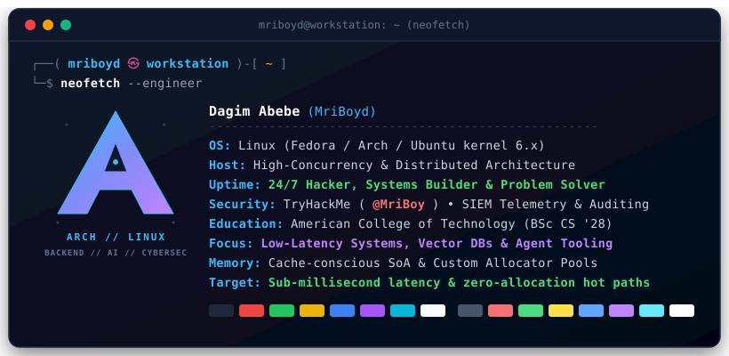

<div align="center">

# Hey there, I'm Dagim Abebe 👋
### Backend & AI Engineer • Cybersec Pro • Distributed Systems

[](https://github.com/MriBoyd)
[](https://linkedin.com/in/dagim-abebe-98590b284/)
[](https://tryhackme.com/p/MriBoy)
[](mailto:mriboyd1240@gmail.com)

<br/>

<a href="https://github.com/MriBoyd">
  
</a>

</div>

---

### ⚡ System Telemetry (`whoami`)

<p align="center">
  
</p>

> **"In a world of bloated abstractions, build close to the metal, optimize for the cache, and trust the telemetry."**  
> I am a backend & AI engineer and cybersec practitioner passionate about high-throughput streaming pipelines, low-level data-oriented programming, distributed architectures, and AI agent ecosystems. I thrive at the intersection of performance, security, and developer infrastructure.

---

### 🛠️ Technical Arsenal

<div align="center">

#### Systems & Core Languages
[](https://www.rust-lang.org/)
[](https://isocpp.org/)
[](https://go.dev/)
[](https://www.python.org/)
[](https://www.typescriptlang.org/)
[](https://developer.mozilla.org/en-US/docs/Web/JavaScript)
[](https://www.java.com/)

#### Backend & Frameworks
[](https://fastapi.tiangolo.com/)
[](https://www.djangoproject.com/)
[](https://nextjs.org/)
[](https://nestjs.com/)
[](https://nodejs.org/)
[](https://react.dev/)
[](https://tailwindcss.com/)
[](https://grpc.io/)
[](https://graphql.org/)

#### Distributed Systems, Storage & Databases
[](https://kafka.apache.org/)
[](https://redis.io/)
[](https://www.postgresql.org/)
[](https://qdrant.tech/)
[](https://www.elastic.co/)
[](https://www.timescale.com/)
[](https://www.mongodb.com/)
[](https://www.sqlite.org/)

#### Cloud, DevOps & Observability
[](https://www.docker.com/)
[](https://kubernetes.io/)
[](https://aws.amazon.com/)
[](https://www.terraform.io/)
[](https://prometheus.io/)
[](https://grafana.com/)
[](https://opentelemetry.io/)
[](https://github.com/features/actions)

#### AI Agents, Semantic Search & Tooling
[](https://www.langchain.com/)
[](https://langchain-ai.github.io/langgraph/)
[](https://modelcontextprotocol.io/)
[](https://qdrant.tech/)

</div>

---

### 🚀 Featured Engineering Projects

<table>
  <tr>
    <td width="50%" valign="top">
      <h3 align="left">🛡️ <a href="https://github.com/MriBoyd/mini-siem-project">Mini SIEM System</a></h3>
      <p><b>High-Throughput Distributed Security Information & Event Management Platform</b></p>
      <ul>
        <li>Engineered a multi-tenant telemetry and SIEM engine sustaining <b>50,000+ logs/sec</b> throughput.</li>
        <li>Evaluates 1,000+ incoming logs in real-time with automated webhook dispatch under <b>&lt; 500ms end-to-end latency</b>.</li>
        <li>Architected fault-tolerant streaming pipelines with <b>Kafka dead-letter queues (DLQs)</b> and end-to-end Grafana dashboards tracking tenant lag.</li>
      </ul>
      <p>
        <code>Rust</code> • <code>Go</code> • <code>Kafka</code> • <code>Redis</code> • <code>Elasticsearch</code> • <code>PostgreSQL</code> • <code>Docker</code> • <code>Kubernetes</code> • <code>Terraform</code> • <code>OpenTelemetry</code>
      </p>
      <a href="https://github.com/MriBoyd/mini-siem-project"><b>View Repository →</b></a>
    </td>
    <td width="50%" valign="top">
      <h3 align="left">🎮 <a href="https://github.com/MriBoyd/game_engine">Archetype Game Engine</a></h3>
      <p><b>High-Performance Data-Oriented Archetype ECS in Modern C++</b></p>
      <ul>
        <li>Built an archetype-based Entity Component System (ECS) using <b>Structure-of-Arrays (SoA)</b> data layouts.</li>
        <li>Simulates and renders <b>10,000+ entities concurrently at 60 FPS</b> within a lean memory footprint of <b>&lt; 200MB</b>.</li>
        <li>Engineered custom memory pools and contiguous block allocators, eliminating heap fragmentation and <b>cutting cache misses by 35%</b> over standard vectors.</li>
      </ul>
      <p>
        <code>C++20</code> • <code>Data-Oriented Design</code> • <code>Archetype ECS</code> • <code>Memory Pools</code> • <code>Cache Optimization</code>
      </p>
      <a href="https://github.com/MriBoyd/game_engine"><b>View Repository →</b></a>
    </td>
  </tr>
  <tr>
    <td width="50%" valign="top">
      <h3 align="left">🤖 <a href="https://github.com/MriBoyd/Ansam">Ansam – MCP Tool Discovery & Proxy</a></h3>
      <p><b>Semantic Discovery Layer & Distributed Proxy for Model Context Protocol (MCP)</b></p>
      <ul>
        <li>Centralized registry indexing <b>10,000+ tools</b> across <b>50+ remote MCP servers</b> with <b>sub-200ms p95 search latency</b>.</li>
        <li>Vectorized tool descriptions into 384-dimensional dense embeddings (<code>all-MiniLM-L6-v2</code>) stored in Qdrant for semantic agent tool matching.</li>
        <li>Implemented secure, controlled remote execution and policy routing across multi-agent environments.</li>
      </ul>
      <p>
        <code>Python</code> • <code>Model Context Protocol (MCP)</code> • <code>Qdrant</code> • <code>LangGraph</code> • <code>RAG</code> • <code>FastAPI</code>
      </p>
      <a href="https://github.com/MriBoyd/Ansam"><b>View Repository →</b></a>
    </td>
    <td width="50%" valign="top">
      <h3 align="left">🔎 <a href="https://github.com/MriBoyd/-FindStuff">FindStuff – Hybrid Search Engine</a></h3>
      <p><b>Multi-Factor Dense Vector & Lexical BM25 Retrieval Engine</b></p>
      <ul>
        <li>Hybrid lost-and-found search platform fusing <b>Qdrant vector embeddings</b> with <b>SQLite FTS5 full-text indexing</b>.</li>
        <li>Multi-factor ranking engine computing weighted scores across semantic similarity, lexical tokens, geographic distance, and temporal decay.</li>
        <li>Offloaded FastEmbed deep learning inference to dedicated background worker threads, preventing event-loop blocking under high load.</li>
      </ul>
      <p>
        <code>FastAPI</code> • <code>TypeScript</code> • <code>SQLite FTS5</code> • <code>Qdrant</code> • <code>FastEmbed</code> • <code>Docker</code>
      </p>
      <a href="https://github.com/MriBoyd/-FindStuff"><b>View Repository →</b></a>
    </td>
  </tr>
  <tr>
    <td width="50%" valign="top">
      <h3 align="left">📅 <a href="https://bahrehasab-frontend.vercel.app">Bahre Hasab Calculation Engine</a></h3>
      <p><b>Modular Astronomical & Liturgical Calendar Engine</b></p>
      <ul>
        <li>Engineered a modular calendar engine supporting <b>50+ interdependent astronomical calculation rules</b> for the Ge'ez calendar.</li>
        <li>Includes full digitizations for Synaxarium (saint-of-the-day biographies), Wedase chants, daily Psalms, and prayers.</li>
        <li>Optimized with multi-tiered <b>Redis caching</b>, slashing computation latency from <b>800ms down to &lt; 50ms</b> on repeat lookups.</li>
      </ul>
      <p>
        <code>Django</code> • <code>Next.js</code> • <code>Redis</code> • <code>PostgreSQL</code> • <code>Vercel</code>
      </p>
      <a href="https://bahrehasab-frontend.vercel.app"><b>Live Application →</b></a>
    </td>
    <td width="50%" valign="top">
      <h3 align="left">📜 <a href="https://github.com/MriBoyd/act_cert_system">Certificate Verification System</a></h3>
      <p><b>High-Volume Cryptographic Certificate Issuance Platform</b></p>
      <ul>
        <li>High-throughput credential generation engine issuing <b>5,000+ certificates/hour</b> with tamper-proof RSA-signed QR codes.</li>
        <li>Provides instant, cryptographically verifiable scans with <b>&lt; 100ms verification response time</b>.</li>
        <li>Complete audit logging and monitoring dashboard tracking all verification requests and tamper attempts.</li>
      </ul>
      <p>
        <code>Django</code> • <code>PostgreSQL</code> • <code>RSA Cryptography</code> • <code>JavaScript</code> • <code>Docker</code>
      </p>
      <a href="https://github.com/MriBoyd/act_cert_system"><b>View Repository →</b></a>
    </td>
  </tr>
</table>

---

### 🎓 Education & Background

```text
🏛️ American College of Technology (ACT)
   Degree:   Bachelor of Science in Computer Science (B.Sc.)
   Timeline: Expected May 2028
   Focus:    Computer Systems, Operating Systems, Algorithms, Security & Distributed Architecture
```

---

### 📬 Connect With Me

<div align="center">

[](https://linkedin.com/in/dagim-abebe-98590b284/)
[](https://tryhackme.com/p/MriBoy)
[](mailto:mriboyd1240@gmail.com)
[](https://github.com/MriBoyd)

<br/>

**⚡ "Always profile first. Optimize cache locality. Build systems that don't fall over."**

</div>
